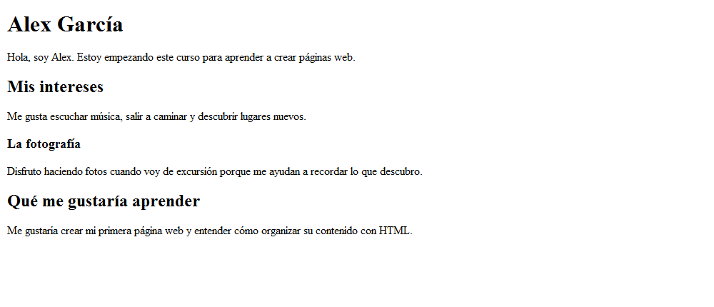
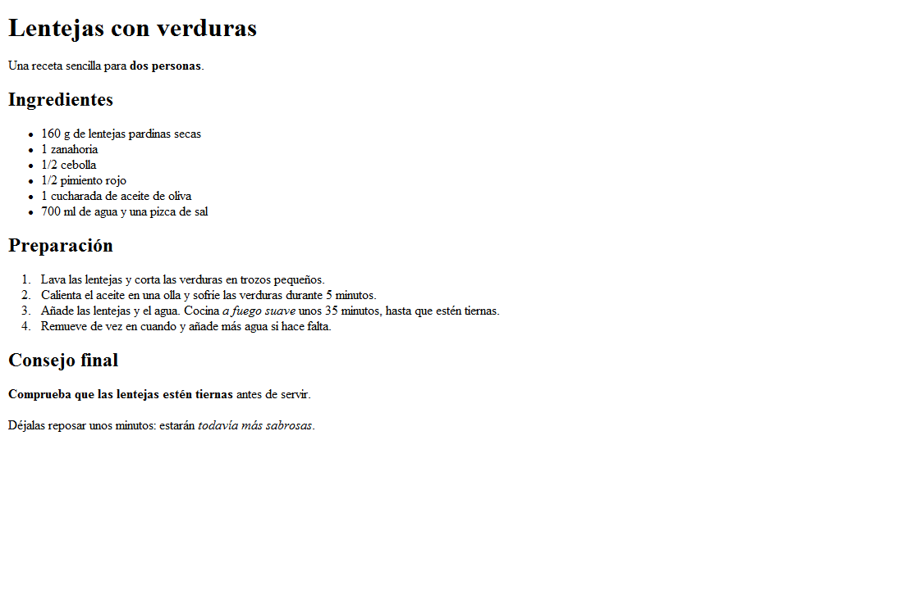

# Ejercicios básicos de HTML

Practicarás cómo estructurar páginas web con HTML. Empieza por **0. Mi presentación** y continúa en orden, según indique el docente. Aquí tienes los enunciados, recursos y pistas de todos los ejercicios.

## Preparar la carpeta

1. Si estás en GitHub, pulsa **Code > Download ZIP**.
2. Busca el ZIP descargado y usa **Extraer todo**. No trabajes dentro del archivo comprimido.
3. Abre Visual Studio Code y elige **Archivo > Abrir carpeta**. Selecciona la carpeta extraída que contiene este README y los ejercicios.
4. Lee el apartado del ejercicio que vas a hacer y abre su referencia visual.
5. Abre el HTML indicado. Si debes crearlo, hazlo dentro de la carpeta del ejercicio y comprueba que termine en `.html`, no en `.html.txt`.

Para leer este README con formato en VS Code, ábrelo y pulsa **Ctrl + Mayús + V**. Los enlaces a archivos son relativos: conserva la carpeta completa para que funcionen después de extraer el ZIP. Si un enlace no se abre en la vista previa, busca el archivo en el explorador de VS Code.

## Instalar Live Server y ver tu página

**Usaremos Live Server desde el primer ejercicio y durante todas estas actividades.** Es una extensión de VS Code que abre tu página en el navegador y la actualiza automáticamente cuando guardas los cambios.

### Si todavía no tienes la extensión

1. En VS Code, abre **Extensiones** en la barra lateral o pulsa **Ctrl + Mayús + X**.
2. Busca **Live Server** y elige la extensión de **Ritwick Dey** (identificador: `ritwickdey.LiveServer`).
3. Pulsa **Instalar / Install**. También puedes acceder desde su [ficha de descarga en Visual Studio Marketplace](https://marketplace.visualstudio.com/items?itemName=ritwickdey.LiveServer).
4. Si VS Code te solicita recargar la ventana para completar la instalación, hazlo.

### Abrir cada ejercicio

1. Comprueba que has abierto la carpeta completa con **Archivo > Abrir carpeta** y abre el HTML del ejercicio.
2. Guarda con **Ctrl + S**.
3. Haz clic derecho sobre ese archivo HTML en el explorador de VS Code y elige **Open with Live Server**.
4. Se abrirá el navegador con una dirección que empieza por `http://127.0.0.1:` o `http://localhost:`. Esa es la pestaña donde comprobarás el ejercicio.
5. Después de cada cambio, guarda con **Ctrl + S** y comprueba el resultado: Live Server actualizará la página automáticamente.

También puedes pulsar **Go Live** en la barra inferior de VS Code con el HTML del ejercicio abierto. Para cambiar de ejercicio, abre su HTML y utiliza **Open with Live Server**.

Si no aparece esa opción, revisa que la extensión esté instalada y habilitada, que hayas abierto la carpeta del proyecto y que el archivo termine en `.html`. Si sigue sin funcionar, pide ayuda al docente.

## Índice de ejercicios

| Ejercicio | Qué practicarás | Referencia |
| --- | --- | --- |
| [0. Mi presentación](#0-mi-presentación) | Encabezados y párrafos, sin atributos | [Imagen](0-mi-presentacion/resultadoEsperado.png) |
| [0b. Receta de lentejas](#0b-receta-de-lentejas-con-verduras) | Listas sencillas, importancia y énfasis | [Imagen](0b-receta-lentejas/resultadoEsperado.png) |
| [1. Tim Berners-Lee](#1-tim-berners-lee) | Encabezados, párrafos y énfasis | [Imagen](1-HTML5_B%C3%A1sico/resultadoEsperado.png) |
| [2. Mi fin de semana](#2-mi-fin-de-semana) | Listas y listas anidadas | [Imagen](2-HTML5_Listas/resultadoEsperado.png) |
| [3. Josep Pla](#3-josep-pla) | Texto preformateado y título de una obra | [Imagen](3-ejercicio-josep-pla/josepPlaDisseny.png) |
| [4. Pokémon](#4-pokémon) | Imágenes y reproducción de una referencia | [Vídeo](https://oscarm.tinytake.com/msc/OTM4NjY0OF8yMjk2MTU4OA) |
| [5. Protectora de animales](#5-protectora-de-animales) | Páginas, imágenes y enlaces | [Imagen](5-ejercicio-protectora/dise%C3%B1oAproximado.png) y [vídeo](https://oscarm.tinytake.com/msc/OTM5MjIyNV8yMjk2ODE2NQ) |
| [6. Detectives de HTML](#6-detectives-de-html) | Localizar y explicar errores | Archivo HTML con errores |

## Cómo trabajar

- Lee qué debes construir antes de escribir código. Identifica títulos, párrafos, listas, imágenes y enlaces.
- Avanza con cambios pequeños y comprueba cada uno en el navegador.
- Reproduce la estructura y el contenido de las referencias. No necesitas copiar exactamente márgenes, tamaños o colores. Estos ejercicios se centran en HTML; no hace falta añadir CSS ni JavaScript.
- La restricción de **no usar atributos** corresponde solo a la presentación. Más adelante los necesitarás para las imágenes y los enlaces.
- Si te atascas, explica qué intentabas hacer, qué has probado y qué ha ocurrido.
- Si utilizas IA, pide una pista o una explicación sobre un paso concreto. Por ejemplo: «Estoy aprendiendo HTML. Estoy haciendo este ejercicio y he probado este código. Dame una pista sin resolverlo entero». Comprueba que entiendes el cambio.

## 0. Mi presentación

### Objetivo y archivo de trabajo

Abre [0-mi-presentacion/index.html](0-mi-presentacion/index.html). La estructura ya está preparada: escribe tu presentación **entre `<body>` y `</body>`**. Puedes usar tu nombre, un apodo o un personaje inventado; comparte solo lo que quieras contar.

El [README de la presentación](0-mi-presentacion/README.md) conserva las pistas ampliadas.

### Qué debes construir

1. Un `h1` con tu nombre o apodo.
2. Un párrafo `p` con una introducción de una o dos frases.
3. Un `h2` titulado «Mis intereses» y un párrafo sobre algo que te guste hacer.
4. Un `h3` con una afición concreta y un párrafo explicando por qué te gusta. Este subapartado pertenece a «Mis intereses».
5. Otro `h2`, «Qué me gustaría aprender», y un párrafo con tu objetivo para el curso.

**Resultado esperado:** un `h1`, dos `h2`, un `h3` y cuatro párrafos. Consulta la [captura de ejemplo](0-mi-presentacion/resultadoEsperado.png). El nombre y los textos son orientativos: escribe tu propia presentación. El aspecto será el que dé el navegador, sin decoración añadida.



**No uses atributos, CSS, JavaScript, imágenes, enlaces ni listas en este ejercicio.**

### Pistas y documentación

- Elige el nivel del encabezado por la organización del contenido, no por el tamaño de la letra.
- Los párrafos van fuera de los encabezados. Cada elemento que añadas aquí necesita apertura y cierre.
- Pulsar Intro en el editor no crea un párrafo nuevo en la página: usa otro elemento `p`.
- [Encabezados y párrafos — MDN](https://developer.mozilla.org/es/docs/Learn_web_development/Core/Structuring_content/Headings_and_paragraphs).

### Comprueba tu trabajo

- [ ] Tengo los cuatro encabezados y los cuatro párrafos indicados.
- [ ] Entiendo por qué la afición lleva `h3` y el objetivo lleva `h2`.
- [ ] No he usado atributos y he cerrado mis etiquetas.
- [ ] He abierto el ejercicio con Live Server y al guardar una frase veo el cambio automáticamente.

**Si terminas antes:** añade otro `h3` con un párrafo dentro de «Mis intereses».

## 0b. Receta de lentejas con verduras

### Objetivo y archivo de trabajo

Haz este ejercicio **después de la presentación y antes de Tim Berners-Lee**. Abre [el HTML base de la receta](0b-receta-lentejas/index.html): contiene toda la receta como texto sin etiquetar. Tu trabajo es organizar ese texto con HTML, sin cambiar el contenido ni escribir la receta de nuevo.

La estructura del documento ya está preparada. Trabaja dentro de `body`; no necesitas modificar `head` ni añadir atributos a tus etiquetas.

### Diseño esperado

[Abre la imagen del resultado esperado](0b-receta-lentejas/resultadoEsperado.png). Es una referencia para organizar el contenido: no necesitas copiar exactamente los tamaños o espacios.



### Qué debes construir

1. Usa **un único `h1`** para «Lentejas con verduras» y un párrafo para la introducción.
2. Usa **tres `h2`**, uno para cada apartado: «Ingredientes», «Preparación» y «Consejo final».
3. Organiza los **seis ingredientes** en una lista desordenada con `ul`. Cada ingrediente debe estar dentro de un `li`.
4. Organiza los **cuatro pasos de preparación** en una lista ordenada con `ol`, cada uno dentro de un `li`. No escribas los números a mano.
5. En «Consejo final», convierte cada una de las dos frases en un párrafo.
6. Utiliza `strong` para destacar **«dos personas»** en la introducción y **«Comprueba que las lentejas estén tiernas»** en el consejo final.
7. Utiliza `em` para enfatizar **«a fuego suave»** en la preparación y **«todavía más sabrosas»** en el último párrafo.

No añadas imágenes, enlaces, CSS ni JavaScript. Tampoco necesitas listas dentro de otras listas.

### Pistas y documentación

- `h1` es el título de toda la receta; los tres `h2` organizan sus apartados al mismo nivel.
- Una lista de ingredientes no necesita un orden concreto; los pasos de preparación sí tienen una secuencia.
- Tanto `ul` como `ol` contienen elementos `li`. Los encabezados de los apartados se colocan fuera de las listas.
- `strong` señala información importante y `em` añade énfasis. Normalmente el navegador los muestra en negrita y cursiva. Colócalos dentro del párrafo o del `li` correspondiente, rodeando solo el fragmento indicado.
- Recuerda cerrar las etiquetas en orden: lo que abres dentro de un elemento se cierra antes que ese elemento.
- No uses `br` repetidos para separar ingredientes o pasos: utiliza las listas.
- [Listas HTML — W3Schools](https://www.w3schools.com/html/html_lists.asp).
- [Énfasis e importancia — MDN](https://developer.mozilla.org/es/docs/Learn_web_development/Core/Structuring_content/Emphasis_and_importance).
- [Encabezados y párrafos — MDN](https://developer.mozilla.org/es/docs/Learn_web_development/Core/Structuring_content/Headings_and_paragraphs).

### Comprueba tu trabajo

- [ ] Tengo un `h1` y exactamente tres `h2`.
- [ ] La introducción y los dos consejos están dentro de sus propios párrafos.
- [ ] Los seis ingredientes aparecen con viñetas y los cuatro pasos numerados.
- [ ] He usado dos `strong` y dos `em` en los fragmentos indicados.
- [ ] No he perdido ni duplicado texto al añadir las etiquetas.
- [ ] He cerrado correctamente las etiquetas y comprobado el resultado en el navegador.

Para terminar, explica por qué los ingredientes usan `ul` y la preparación usa `ol`.

## 1. Tim Berners-Lee

### Objetivo y archivo de trabajo

Edita [Berners-Lee-Wikipedia.html](1-HTML5_B%C3%A1sico/Berners-Lee-Wikipedia.html) para organizar la biografía que ya contiene. Practicarás encabezados, párrafos y fragmentos de texto destacados.

### Diseño esperado y pasos

Abre la [imagen del resultado esperado](1-HTML5_B%C3%A1sico/resultadoEsperado.png).

1. Corrige el título visible para que diga «Biografía de Tim Berners Lee», como en la referencia.
2. Separa los dos primeros párrafos: el trabajo inicial en el CERN y la etapa posterior en otra empresa.
3. Añade el apartado «El nacimiento de la web» con un encabezado de segundo nivel.
4. Organiza debajo los dos párrafos sobre la propuesta de la Web y su revisión.
5. Identifica en la imagen las palabras destacadas en negrita y cursiva e introduce las etiquetas correspondientes.

El resultado es **aproximado**: no hace falta reproducir los márgenes ni la imagen tenue que aparece en el fondo de la captura.

### Pistas y documentación

- Parte del texto está suelto en el HTML inicial. Decide dónde empieza y termina cada párrafo.
- `strong` expresa importancia y `em` énfasis; suelen verse en negrita y cursiva. Envuelve solo el fragmento que quieras destacar.
- El título de la pestaña se configura en `title`; el encabezado visible pertenece al `body`.
- [Énfasis e importancia — MDN](https://developer.mozilla.org/es/docs/Learn_web_development/Core/Structuring_content/Emphasis_and_importance).

### Comprueba tu trabajo

- [ ] He conservado el contenido de la biografía y corregido el encabezado inicial.
- [ ] Hay un título principal, un apartado de segundo nivel y cuatro párrafos.
- [ ] He reproducido los fragmentos destacados sin convertir párrafos enteros en encabezados.
- [ ] No he añadido la imagen de fondo de la captura.

## 2. Mi fin de semana

### Objetivo y archivo de trabajo

Edita [2-HTML5_Listas/index.html](2-HTML5_Listas/index.html). El título principal ya está escrito. Practicarás listas con viñetas, listas numeradas y una lista dentro de otra.

### Diseño esperado y contenido

Abre la [imagen del resultado esperado](2-HTML5_Listas/resultadoEsperado.png) y construye estos tres apartados con encabezados `h2`:

- **Cosas que quiero hacer:** lista con viñetas con «Ir a la playa», «Leer un libro», «Jugar a videojuegos» y «Salir a caminar».
- **Horario del sábado:** lista numerada con «Desayunar», «Hacer deporte», «Comer», «Ver una película» y «Cenar».
- **Material para la playa:** lista con viñetas con «Ropa cómoda», «Mochila» y «Chanclas». Dentro de «Mochila» debe aparecer otra lista con «Toalla», «Crema solar», «Gafas de sol» y «Agua».

### Pistas y documentación

- Usa `ul` cuando el orden no sea relevante y `ol` para la secuencia del sábado.
- Cada elemento de una lista va dentro de `li`; no escribas números ni viñetas a mano.
- La lista del contenido de la mochila debe estar **dentro del `li` de Mochila**, antes de cerrarlo.
- Indenta el código para reconocer qué lista está dentro de cuál.
- [Listas HTML — W3Schools](https://www.w3schools.com/html/html_lists.asp), recurso de las instrucciones originales.

### Comprueba tu trabajo

- [ ] Tengo tres apartados y he elegido el tipo de lista adecuado en cada uno.
- [ ] La numeración la genera el navegador.
- [ ] El contenido de la mochila aparece un nivel más adentro y pertenece a su `li`.
- [ ] Todas las listas y sus elementos están cerrados correctamente.

## 3. Josep Pla

### Objetivo y archivo de trabajo

Crea desde cero un archivo **`index.html` dentro de `3-ejercicio-josep-pla`**. Reproduce el texto y su organización a partir de la [imagen de referencia](3-ejercicio-josep-pla/josepPlaDisseny.png).

### Qué debes construir

1. Prepara la estructura básica del documento: declaración `<!DOCTYPE html>`, `html`, `head`, `title` y `body`. Indica la codificación UTF-8 con `meta charset="UTF-8"`.
2. Transcribe el poema de la captura respetando sus saltos de línea y sangrías.
3. Debajo, añade el nombre del autor y el título de la obra, «Notes per a Sílvia», que aparece en cursiva.

La barra del navegador, la dirección local y los datos de Chrome y Windows **no forman parte de la página que debes crear**.

### Pistas y documentación

- El HTML habitual agrupa los espacios y saltos de línea del código. Investiga `pre` para conservar el formato del poema.
- Dentro de `pre`, los espacios que escribas para indentar el poema también se verán: compáralos con la imagen.
- Para el título de una obra puedes consultar `cite`.
- [Texto preformateado: `pre` — MDN](https://developer.mozilla.org/es/docs/Web/HTML/Reference/Elements/pre).
- [Título de una obra: `cite` — MDN](https://developer.mozilla.org/es/docs/Web/HTML/Reference/Elements/cite).

### Comprueba tu trabajo

- [ ] Mi archivo está en la carpeta del ejercicio y se abre como una página web.
- [ ] El poema conserva las líneas, los espacios y los acentos de la referencia.
- [ ] He añadido el autor y el título de la obra.
- [ ] No he copiado elementos de la interfaz del navegador.

## 4. Pokémon

### Objetivo y archivo de trabajo

Crea un **`index.html` dentro de `4-ejercicio-pokemon`** y reproduce el diseño y el comportamiento que muestra el vídeo de referencia, como piden las instrucciones originales.

### Referencia y recursos

- **[Ver el vídeo del ejercicio de Pokémon](https://oscarm.tinytake.com/msc/OTM4NjY0OF8yMjk2MTU4OA).** Es la referencia del resultado esperado; no hay captura del diseño completo en esta carpeta.
- Imágenes disponibles: [charmander.png](4-ejercicio-pokemon/img/charmander.png), [charmillion.png](4-ejercicio-pokemon/img/charmillion.png) y [charizar.png](4-ejercicio-pokemon/img/charizar.png).

Los nombres de los archivos son los que ya vienen en la carpeta, aunque no coincidan con la escritura habitual de los nombres de los Pokémon. Usa el nombre real del archivo en las rutas.

### Cómo abordarlo

1. Mira el vídeo completo antes de escribir. Anota los textos, las imágenes, su orden y qué ocurre cuando se interactúa con la página.
2. Prepara la estructura HTML y añade primero el contenido de texto.
3. Incorpora las imágenes desde `img` con el atributo `src` y un texto alternativo `alt` apropiado.
4. Reproduce los enlaces o la navegación que observes en la referencia y compruébalos uno a uno.
5. Compara tu resultado con el vídeo, sin añadir funcionalidades que no se hayan pedido.

### Pistas y documentación

- Desde el `index.html` del ejercicio, las imágenes se buscan en `img/nombre-del-archivo.png`.
- `src` indica dónde está la imagen; `alt` describe su contenido. `img` no lleva etiqueta de cierre.
- Si una imagen no aparece, revisa su nombre, extensión y ruta antes de cambiar el resto del código.
- Si el vídeo muestra un salto a una parte de la misma página, consulta los enlaces con `href="#identificador"` y el atributo `id` en el destino.
- [Imágenes: `img` — MDN](https://developer.mozilla.org/es/docs/Web/HTML/Reference/Elements/img).
- [Enlaces: `a` — MDN](https://developer.mozilla.org/es/docs/Web/HTML/Reference/Elements/a).

### Comprueba tu trabajo

- [ ] He seguido el contenido, el orden y el comportamiento del vídeo.
- [ ] Las imágenes cargan desde la carpeta del ejercicio y tienen texto alternativo.
- [ ] He probado cada enlace o salto que he añadido.
- [ ] Las rutas no dependen de una carpeta personal como `C:\Users\...`.

## 5. Protectora de animales

### Objetivo y archivos de trabajo

Construye un sitio para **PROGAT/PROGATS**, una protectora que anuncia gatos perdidos en la zona de Girona. Practicarás imágenes, listas y enlaces entre páginas de carpetas diferentes.

La imagen usa «PROGAT» y el PDF «PROGATS»: ambas referencias pertenecen al mismo ejercicio. Usa un nombre coherente en tus páginas.

### Diseño esperado y materiales

- **[Vídeo del ejercicio de la protectora](https://oscarm.tinytake.com/msc/OTM5MjIyNV8yMjk2ODE2NQ):** referencia del diseño y del comportamiento.
- **[Imagen del diseño aproximado](5-ejercicio-protectora/dise%C3%B1oAproximado.png):** muestra la página principal.
- **[PDF con los requisitos originales](5-ejercicio-protectora/requisitosWeb.pdf):** describe la página principal y las páginas de cada zona. Sus requisitos se recogen a continuación.
- [Vídeo promocional de YouTube](https://www.youtube.com/watch?v=zmXtcnZcq4g): es el contenido que aparece incrustado en la captura, distinto del vídeo que explica el ejercicio.
- Recursos gráficos: [logoProgats.png](5-ejercicio-protectora/img/logoProgats.png), [bertin.jpg](5-ejercicio-protectora/img/bertin.jpg), [gloria.jpg](5-ejercicio-protectora/img/gloria.jpg) y [thyseen.jpg](5-ejercicio-protectora/img/thyseen.jpg).

### Parte A. Página principal

Edita [5-ejercicio-protectora/index.html](5-ejercicio-protectora/index.html). Debe contener:

1. El nombre y el logotipo de la protectora.
2. Una pequeña descripción de lo que hace la asociación.
3. Una lista de enlaces a las tres zonas: **Girona, Sant Feliu de Guíxols y Palamós**. Cada enlace debe abrir la página de su localidad.
4. El vídeo promocional de YouTube que aparece en la referencia.
5. Al final, el teléfono y el correo de contacto. El correo debe ser un enlace que abra la aplicación de correo.

La captura muestra el teléfono **972727272** y el correo **progat@progat.com**. Úsalos como datos del ejercicio; basta con comprobar el enlace, sin enviar mensajes ni realizar llamadas.

**Aclaración:** aunque la imagen presenta los enlaces de las ciudades en una línea, el PDF solicita una lista de enlaces. Utiliza una lista HTML; no necesitas CSS para colocarla en una línea.

### Parte B. Páginas de gatos perdidos

Los tres archivos ya están creados dentro de `ciudades-gatos-perdidos`:

- [gatosPerdidosGirona.html](5-ejercicio-protectora/ciudades-gatos-perdidos/gatosPerdidosGirona.html).
- [gatosPerdidosSantFeliuDeGuixols.html](5-ejercicio-protectora/ciudades-gatos-perdidos/gatosPerdidosSantFeliuDeGuixols.html).
- [gatosPerdidosPalamos.html](5-ejercicio-protectora/ciudades-gatos-perdidos/gatosPerdidosPalamos.html).

En cada página debes incluir:

1. El nombre de la protectora y su logotipo. **Al pulsar el logotipo se debe volver a la página principal.**
2. La localidad correspondiente, identificada con un encabezado.
3. Los gatos perdidos de esa zona. Puede haber **cero, uno o varios gatos**, según los requisitos originales. Para cada gato: nombre como encabezado, descripción de dónde se perdió y sus rasgos, y fotografía.
4. Al final, el correo y el teléfono de contacto.

Si la referencia no concreta los datos de algún gato, escribe una descripción ficticia para practicar. Si una localidad no tiene gatos, indícalo con un párrafo. No hace falta implementar un buscador ni un formulario.

### Orden recomendado

1. Completa los textos, la lista y el logo de la página principal.
2. Enlaza las tres localidades y comprueba que abren sus archivos.
3. Completa una página de localidad y prueba el logo para volver al inicio.
4. Añade los gatos y comprueba las fotografías.
5. Completa las otras dos páginas y revisa toda la navegación.
6. Añade los enlaces de contacto y el vídeo incrustado.

### Pistas sobre rutas y enlaces

| Desde dónde escribes la ruta | Destino | Ruta |
| --- | --- | --- |
| Página principal | Imagen del logo | `img/logoProgats.png` |
| Página principal | Página de Girona | `ciudades-gatos-perdidos/gatosPerdidosGirona.html` |
| Página de una localidad | Página principal | `../index.html` |
| Página de una localidad | Imagen del logo | `../img/logoProgats.png` |

- `../` permite subir un nivel de carpeta. Calcula las rutas desde el HTML que estás editando, no desde el README.
- Para que el logo sea clicable, coloca su `img` dentro de un enlace `a`.
- Para el correo, investiga `mailto:`. Para un teléfono clicable puedes usar `tel:`.
- Para incrustar el vídeo, busca en YouTube **Compartir > Insertar**. Revisa el `iframe`, añade un `title` descriptivo y usa la dirección de inserción, no la URL normal de reproducción.
- El vídeo necesita Internet. Si YouTube bloquea su reproducción incrustada, conserva también un enlace para abrirlo en YouTube y coméntalo con el docente.

### Documentación

- [Enlaces y correo: `a` — MDN](https://developer.mozilla.org/es/docs/Web/HTML/Reference/Elements/a).
- [Imágenes y texto alternativo: `img` — MDN](https://developer.mozilla.org/es/docs/Web/HTML/Reference/Elements/img).
- [Contenido incrustado: `iframe` — MDN](https://developer.mozilla.org/es/docs/Web/HTML/Reference/Elements/iframe).

### Comprueba tu trabajo

- [ ] La página principal incluye el nombre, el logo, la descripción y los enlaces a las tres localidades.
- [ ] Cada enlace abre la localidad correcta y cada logo permite volver al inicio.
- [ ] Los gatos que he incluido tienen nombre, descripción y fotografía con texto alternativo.
- [ ] En las cuatro páginas aparecen los datos de contacto.
- [ ] El correo utiliza `mailto:`. Si no se abre una aplicación, he revisado la ruta y la configuración de correo del equipo.
- [ ] He incorporado el vídeo promocional o comprobado con el docente una limitación de reproducción.
- [ ] Las imágenes funcionan también en las páginas de las subcarpetas.

## 6. Detectives de HTML

### Objetivo y archivo de trabajo

Abre [6-errorsHTML/index.html](6-errorsHTML/index.html). Las instrucciones originales piden localizar **cinco errores intencionados** y añadir un comentario al lado de cada uno explicando el problema.

### Qué debes hacer

1. Abre la página en el navegador y lee también su código en VS Code.
2. Busca los cinco errores. Que el navegador muestre algo no significa que el HTML esté bien escrito.
3. Añade junto a cada error un comentario HTML con tu explicación. Por ejemplo, con un caso distinto a los del archivo:

   ```html
   <!-- Aquí falta el cierre del párrafo antes de empezar el siguiente elemento. -->
   ```

4. Explica qué cambiarías y por qué. El objetivo original es **identificar y comentar**; conserva el código problemático para que pueda revisarse.
5. Si el docente propone corregirlo después, guarda primero una copia como `corregido.html` y aplica allí los cambios.

### Pistas: consulta solo lo que necesites

<details>
<summary>Por dónde empezar a buscar</summary>

Revisa la diferencia entre la información del documento y su contenido visible, los atributos y el texto de los enlaces, el contenido que puede ir dentro de un encabezado y el orden de cierre de las etiquetas anidadas.

No cuentes cualquier mejora posible como uno de los cinco errores: un texto redundante no siempre es HTML inválido.

</details>

### Documentación y comprobación

- [Sintaxis básica de HTML — MDN](https://developer.mozilla.org/es/docs/Learn_web_development/Core/Structuring_content/Basic_HTML_syntax).
- [Referencia de elementos HTML — MDN](https://developer.mozilla.org/es/docs/Web/HTML/Reference/Elements).
- [Enlaces: `a` — MDN](https://developer.mozilla.org/es/docs/Web/HTML/Reference/Elements/a).

- [ ] He localizado los cinco errores intencionados.
- [ ] Cada comentario explica el problema y cómo se resolvería.
- [ ] He distinguido un error de HTML de una preferencia de presentación.
- [ ] Puedo explicar por qué el navegador disimula algunos errores.

## Ayuda común: cuando algo no funciona

| Qué ocurre | Qué revisar |
| --- | --- |
| No veo mis cambios | Guarda con Ctrl + S y comprueba que estás viendo el mismo HTML abierto con Live Server, en una dirección `http://127.0.0.1:` o `http://localhost:`. Si el servidor se ha detenido, vuelve a usar Open with Live Server. |
| Veo las etiquetas como texto | Comprueba que el nombre termina en `.html`, no en `.html.txt`. |
| No aparece una imagen | Revisa `src`, el nombre exacto, la extensión y la carpeta desde la que se calcula la ruta. |
| Un enlace no abre el destino | Revisa `href`, el nombre del archivo y si tienes que entrar o salir de una carpeta. |
| Los acentos se ven mal | Guarda el HTML en UTF-8 e indica `<meta charset="UTF-8">` en `head`, salvo en el ejercicio 0, donde la plantilla se trabaja sin atributos. |
| Las listas se ven extrañas | Revisa que cada elemento esté dentro de `li` y que una sublista pertenezca a un `li` de la lista exterior. |

## Documentación general y soluciones

- [Sintaxis básica de HTML — MDN](https://developer.mozilla.org/es/docs/Learn_web_development/Core/Structuring_content/Basic_HTML_syntax): apertura, cierre y anidamiento.
- [Encabezados y párrafos — MDN](https://developer.mozilla.org/es/docs/Learn_web_development/Core/Structuring_content/Headings_and_paragraphs): jerarquía y organización del texto.
- [Referencia de etiquetas — W3Schools](https://www.w3schools.com/tags/default.asp): consulta de elementos.

La carpeta también contiene `solucionesHTMLBasic.zip`. Consúltalo cuando indique el docente, después de haber hecho tu intento. Utiliza las soluciones para comparar y explicar diferencias, no solo para copiar el resultado.
